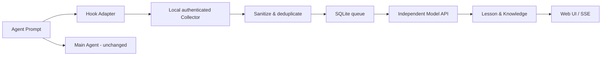

# English Learning Sidecar

**An always-available, private, non-intrusive English learning companion for coding agents.**

English Sidecar receives a **copy of your prompt** from an Agent Hook, analyzes it via a separate, optional OpenAI-compatible model API, and renders an English lesson in its own browser UI. The main Agent does not know about the English lesson and never waits for the model's teaching response.

  

## Features

- **Independent pipeline** — native Hooks → authenticated localhost collector → async learning model → SQLite → live Web UI.
- **Codex, Cursor and Claude Code adapters** — dry-run/opt-in safe installer; existing hooks are preserved with backups.
- **Pi extension** — fire-and-forget raw input observation; no prompt transformation.
- **Provider independent** — OpenAI-compatible `/chat/completions`; bring your own API key.
- **Learning cards** — Chinese → fluent English, real English corrections, vocabulary, grammar, examples, usage, recap.
- **Knowledge library** — deduplicated vocabulary and grammar records across conversations.
- **Private by default** — binds only to `127.0.0.1`, authenticated capture endpoint, no third-party fonts, sanitized local storage, no raw secret retention.
- **Pause/resume & history** — controlled from Web UI. Failed analyses can be manually retried.

## Quick start

Requires **Node.js >= 22.13**. No `npm install` is required.

```bash
cp .env.example .env
npm start
# open http://127.0.0.1:4317
```

With no `LEARNING_API_KEY`, the app starts in **Demo preview** mode. Demo lessons are fixed examples and are **not** genuine analyses of the submitted text. For a live model, edit `.env`:

```ini
LEARNING_MODE=live
LEARNING_API_KEY=YOUR_KEY_HERE
LEARNING_BASE_URL=https://api.openai.com/v1
LEARNING_MODEL=gpt-4o-mini
```

Restart `npm start`. The `LEARNING_API_KEY` is never served to the browser or stored in SQLite.

Send a local smoke-test prompt, without Agent installation:

```bash
npm run smoke
# or run npm run dev to enable a UI sample button
```

## Install an Agent Hook

Run from inside the Sidecar project. By default the installer targets **the current project** (least privilege), and only previews changes unless you explicitly add `--apply`:

```bash
node bin/install-hooks.cjs codex                 # preview
node bin/install-hooks.cjs codex --apply         # project-only
node bin/install-hooks.cjs cursor --apply        # project-only
node bin/install-hooks.cjs claude --apply        # project-only

# To observe every local project (consider privacy first):
node bin/install-hooks.cjs codex --scope=user --apply
```

This installer handles **Codex, Cursor, Claude Code**. The **Pi** extension resides at `extensions/pi/english-sidecar.ts` and can be installed at `~/.pi/agent/extensions/`. Qoder and DSH can use the generic collector API but do not yet have verified dedicated installers. See [the integration guide](docs/INTEGRATIONS.md).

**Codex:** open `/hooks` and review/trust the hook after installation. No trust bypass is used.

## Architecture



- A Hook process uses a short local request deadline and exits successfully even if the Sidecar is unavailable. For Codex/Claude it emits **no stdout**, preventing context injection. For Cursor it emits the schema-required `{"continue":true}` only.
- Async work is durable in SQLite; unfinished jobs resume after restart. New inputs get a `202 Accepted` response after local persistence.
- The HTTP server never binds to the LAN. The ingestion endpoint requires a random local bearer token saved at `~/.english-sidecar/ingest-token` with restrictive file permissions where supported.

## Privacy and limitations

- Prompt content is redacted **before persistence and before any external model request**, using best-effort secret and email patterns. **Regex filtering cannot guarantee perfect detection of confidential data**. Avoid installing in sensitive workspaces; do not grant external API use without appropriate authorization.
- The UI is available to software on your local machine at `127.0.0.1:4317`; it has no separate user login. Do not expose it via a tunnel, reverse proxy or public network without additional authentication.
- MVP captures only text. Images, attached files, transcripts, and tool results are intentionally excluded. `assistant.reply` can be stored but is not analyzed.
- Background errors are recorded; the main Agent never blocks on analysis completion. Actual Hook execution still incurs a small startup/local-IPC overhead.
- Dedup uses source/session/turn IDs when present. Sources without turn IDs use a short time bucket and can miss some rapid repeats.
- Windows was not validated for Hook shell quoting or POSIX permissions.
- Demo mode must not be interpreted as real translation.

## Always-on deployment

For a macOS login service, see [Always-on setup](docs/ALWAYS_ON.md). The MVP runs locally; it is not a hosted or cloud background service.

## Development and verification

```bash
npm test              # Node built-in test runner; no network required
SIDECAR_DEMO=1 npm start
```

Suggested next steps: real-provider integration test, finer privacy/project allowlists, automatic opt-in assistant reply capture, Qoder and DSH Adapter validation, spaced repetition and learning progress.

## API surface

| Route | Purpose |
| --- | --- |
| `GET /api/status` | Mode, paused state, counters |
| `GET /api/events` | Local event history |
| `GET /api/knowledge` | Learned words and grammar |
| `GET /api/stream` | SSE updates |
| `POST /api/events` | Authenticated Agent collection (`X-Sidecar-Token`) |
| `POST /api/settings` | Pause/resume local collection |
| `POST /api/demo` | Manual example, only when `SIDECAR_DEMO=1` |
| `POST /api/events/:id/retry` | Retry a failed analysis |
| `DELETE /api/events/:id` | Delete locally saved event |

## Attribution

Architecture is independent of any single Agent. Hook examples align with the official [Codex](https://learn.chatgpt.com/docs/hooks), [Cursor](https://cursor.com/docs/hooks), [Claude Code](https://code.claude.com/docs/en/hooks), and [Pi](https://pi.dev/docs/latest/extensions) docs, and should be revalidated against the installed Agent version.
